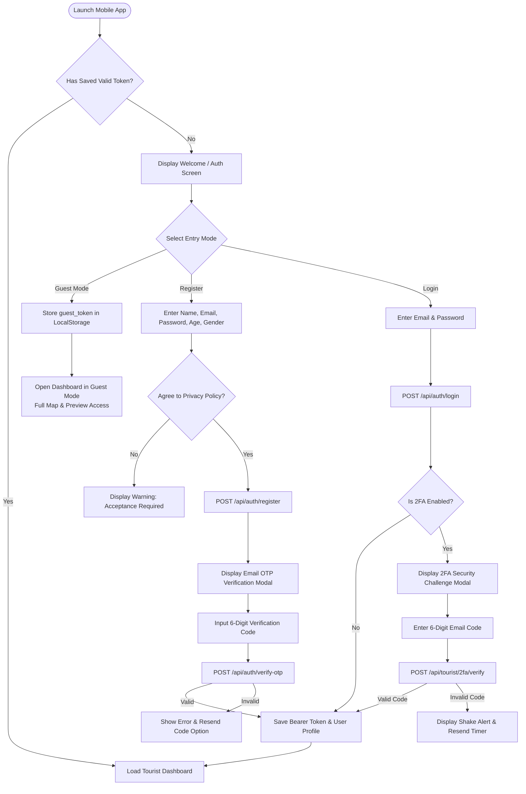
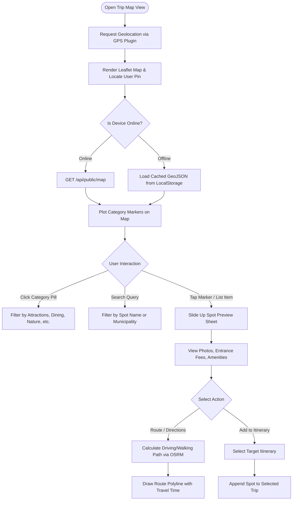

# Intan-Elyu Tourism Management System
## Application Flow & User Journeys (App Flow)

| **Document Version** | 2.4.0 |
| **System** | Intan-Elyu Smart Tourism Platform |
| **Diagram Engine** | Mermaid Markdown Visualizations |

---

## 1. Authentication, Onboarding & 2FA Verification Flow

This flowchart illustrates the user onboarding journey, including Guest Exploration Mode, Email/Password login with optional/enforced Two-Factor Authentication (2FA), and Google OAuth.



---

## 2. Interactive Map & Spot Discovery Flow

Tourists and guests can explore destinations, filter by category, view spot details, and trigger navigation.



---

## 3. Itinerary Planning, Check-in & Photo Upload Flow

The core travel journey allows tourists to organize multi-day trips, track companions, calculate budgets, and complete verified check-ins.

```mermaid
flowchart TD
    SavedTrips([Open Saved Trips Tab]) --> LoadTrips[Render Cached Multi-Day Trips]
    
    LoadTrips --> TripChoice{User Action}
    
    TripChoice -- Create New Trip --> InputTripMeta[Enter Title, Dates, Companion Pax]
    InputTripMeta --> SaveNewTrip[POST /api/tourist/itineraries]
    SaveNewTrip --> LoadTrips
    
    TripChoice -- Open Trip Details --> ViewTripItems[Display Ordered Destinations]
    ViewTripItems --> SpotCard[Inspect Destination Card]
    
    SpotCard --> CheckInChoice{Choose Check-in Method}
    
    CheckInChoice -- GPS Quick Check-in --> GeoValidate{Is User Within Spot Radius?}
    GeoValidate -- Yes --> PostQuickCheck[POST .../checkin]
    GeoValidate -- No --> RadiusAlert[Show Alert: Too Far from Coordinates]
    
    CheckInChoice -- Photo Proof Modal --> OpenProofModal[Open 3-Section Photo Modal<br/>Header: Royal Blue, Middle: White]
    
    OpenProofModal --> PhotoSelect{Select Media}
    PhotoSelect -- Camera --> TriggerNativeCamera[Capacitor Camera Plugin]
    PhotoSelect -- Gallery --> OpenImagePicker[Select up to 5 Photos]
    
    TriggerNativeCamera --> CompressPhotos[Client-Side Canvas Compression<br/>1280px Max, 80% JPEG]
    OpenImagePicker --> CompressPhotos
    
    CompressPhotos --> RenderThumbnails[Render Thumbnails in White Middle Body]
    RenderThumbnails --> SubmitProof[Click 'Submit' Button in Footer]
    
    SubmitProof --> NetworkCheck{Is Device Online?}
    NetworkCheck -- Online --> UploadR2[POST /api/tourist/itineraries/items/{id}/proof]
    UploadR2 --> OptimisticSuccess[Mark Visited Locally + Trigger Confetti]
    
    NetworkCheck -- Offline --> QueueOffline[Queue in OfflineCheckinManager]
    QueueOffline --> ShowOfflineToast[Show Toast: 'Saved Offline! Auto-syncs when online']
    ShowOfflineToast --> OptimisticSuccess
```

---

## 4. Offline Synchronization Pipeline (`OfflineCheckinManager`)

```mermaid
flowchart TD
    OfflineEvent([User Submits Check-in While Disconnected]) --> EncodeData[Package Metadata & Convert Photo to Blob]
    EncodeData --> AppendQueue[Push to 'intan_elyu_offline_queue' in Storage]
    AppendQueue --> UpdateBadge[Display Amber Offline Sync Badge]
    
    UpdateBadge --> IdleState([Wait for Network Reconnection])
    
    IdleState --> DetectOnline{Network State Changed?}
    DetectOnline -- Event: 'online' or Resume --> TriggerSync[OfflineCheckinManager.syncOfflineQueue()]
    
    TriggerSync --> ReadQueue[Fetch Items from Storage FIFO]
    ReadQueue --> HasItems{Queue Empty?}
    
    HasItems -- Yes --> HideBadge[Hide Offline Sync Badge]
    HasItems -- No --> PopItem[Extract Head Item from Queue]
    
    PopItem --> PostBackend[Upload Payload & Photo to Backend API]
    PostBackend --> SuccessResponse{Server Response 200 OK?}
    
    SuccessResponse -- Yes --> RemoveQueueItem[Delete Item from Queue]
    RemoveQueueItem --> HasItems
    
    SuccessResponse -- No / Timeout --> ExponentialBackoff[Wait 5s Retry Backoff]
    ExponentialBackoff --> PostBackend
```

---

## 5. Gamification, GameZone & Voucher Claim Pass Flow

```mermaid
flowchart TD
    OpenGameZone([Open GameZone Hub]) --> CheckGuest{Is User Guest?}
    CheckGuest -- Yes --> ShowRestrictedModal[Prompt Account Creation to Earn XP]
    CheckGuest -- No --> SelectGame[Choose: Slider Puzzle, Word Scramble, Trivia]
    
    SelectGame --> PlayGame[Solve Interactive Challenge]
    PlayGame --> CompleteGame{Puzzle Solved?}
    
    CompleteGame -- Yes --> AwardPoints[Increment User XP & Activity Count]
    AwardPoints --> UpdateLevel[Calculate Level: floor(XP / 1000) + 1]
    UpdateLevel --> ViewVouchers[Open Rewards Marketplace]
    
    ViewVouchers --> SelectVoucher[Select Partner Merchant Voucher]
    SelectVoucher --> VerifyBalance{Sufficient XP Balance?}
    VerifyBalance -- No --> PromptMoreActivities[Show 'Insufficient Points' Warning]
    VerifyBalance -- Yes --> ConfirmClaim[Confirm Redemption]
    
    ConfirmClaim --> GeneratePass[POST /api/vouchers/claim]
    GeneratePass --> DisplayQRPass[Generate Live Digital QR Claim Pass<br/>Dynamic Countdown Timer + Security Pattern]
    
    DisplayQRPass --> PresentMerchant[Present to Partner Merchant Staff]
    PresentMerchant --> StaffScan[Staff Scans QR via Portal / Camera]
    StaffScan --> MarkRedeemed[Mark Voucher as Used in Database]
```

---

## 6. Administrative Spot Audit & Proof Review Flow

```mermaid
flowchart TD
    AdminLogin([Tourism Officer Login]) --> AdminDashboard[Access Admin Management Hub]
    AdminDashboard --> ProofQueue[Navigate to 'Proof Check-ins' Audit Tab]
    
    ProofQueue --> FilterStatus[Filter by Pending, Approved, Rejected]
    FilterStatus --> ReviewItem[Open Tourist Submission Card]
    ReviewItem --> InspectPhotos[View Cloudflare R2 High-Resolution Photos]
    
    InspectPhotos --> Decision{Audit Determination}
    
    Decision -- Approve --> CallApprove[POST /api/admin/proof-checkins/{id}/approve]
    CallApprove --> CreditXP[Credit Official Classification Points to Tourist]
    CreditXP --> SendNotice[Dispatch Notification: Check-in Approved]
    
    Decision -- Reject --> EnterReason[Input Rejection Explanation]
    EnterReason --> CallReject[POST /api/admin/proof-checkins/{id}/reject]
    CallReject --> SendRejectNotice[Dispatch Notification with Rejection Reason]
```
