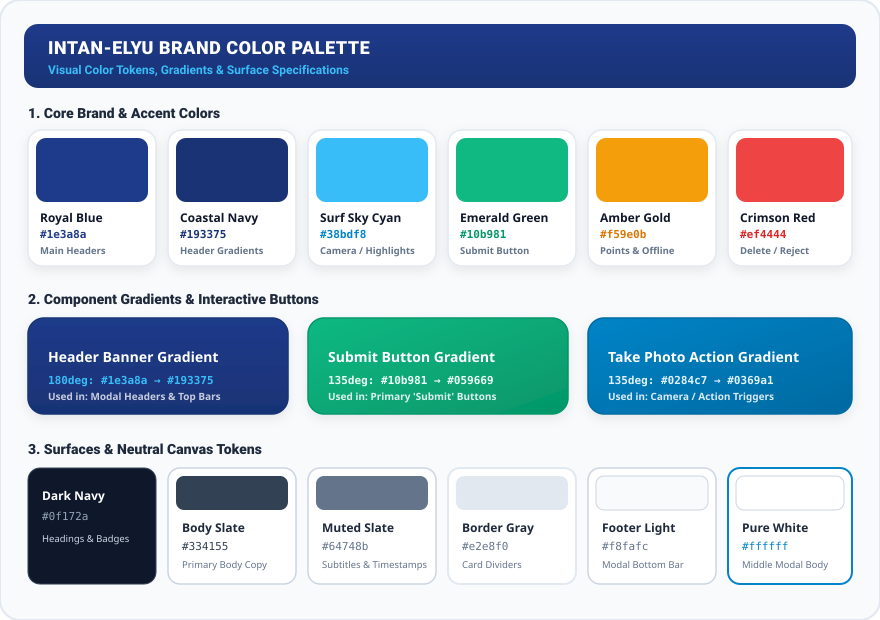

# Intan-Elyu Tourism Management System
## UI/UX Design Brief & Design System Specification

| **Document Version** | 2.4.0 |
| **Aesthetic Theme** | Coastal Modern Glassmorphism & High-Contrast Tropical Elegance |
| **Target Viewport** | 360px – 430px (Mobile-first Android), Responsive Tablet & Desktop |
| **Design System Standard** | Intan-Elyu Mobile Design Tokens |

---

## 1. Design Philosophy & Creative Vision

La Union ("Elyu") represents a unique fusion of vibrant surf culture, tranquil coastal seascapes, colonial heritage, and lush agricultural mountains. The design system for **Intan-Elyu** captures this identity through:

1. **Coastal Elegance with Purpose**: Rich deep ocean blues, crisp surf aqua, and lush emerald accents balanced with clean, pure white content surfaces.
2. **Outdoor Sun-Readability**: High contrast typography and solid background containers ensure travelers can effortlessly view itineraries, maps, and camera check-in tools under bright tropical sunlight.
3. **Ergonomic Thumb-Zone Usability**: Interactive elements, primary submission buttons, bottom navigation, and search drawers are positioned within natural thumb reach, avoiding top-screen stretching on modern tall smartphones.
4. **Delightful Micro-Interactions**: Tactile button down-press scaling (`transform: scale(0.97)`), pop-in modal transitions, celebratory check-in confetti bursts, and smooth drawer gesture handling.

---

## 2. Color Palette & Design Tokens

### Visual Color Palette Board


### 2.1 Primary & Accent Swatches

| Color Swatch | Token Name | Hex Code | Visual Application |
| :---: | :--- | :--- | :--- |
| <svg width="24" height="24" style="vertical-align:middle;"><rect width="24" height="24" rx="6" fill="#1e3a8a"/></svg> | `--color-primary-dark` | `#1e3a8a` | Modal header backgrounds, brand title typography, primary navigation. |
| <svg width="24" height="24" style="vertical-align:middle;"><defs><linearGradient id="g1" x1="0" y1="0" x2="0" y2="1"><stop offset="0%" stop-color="#1e3a8a"/><stop offset="100%" stop-color="#193375"/></linearGradient></defs><rect width="24" height="24" rx="6" fill="url(#g1)"/></svg> | `--color-primary-gradient` | `linear-gradient(180deg, #1e3a8a 0%, #193375 100%)` | Top modal header banners, feature hero banners. |
| <svg width="24" height="24" style="vertical-align:middle;"><rect width="24" height="24" rx="6" fill="#193375"/></svg> | `--color-coastal-navy` | `#193375` | Dark gradient anchor, night-mode cards. |
| <svg width="24" height="24" style="vertical-align:middle;"><rect width="24" height="24" rx="6" fill="#38bdf8"/></svg> | `--color-accent-cyan` | `#38bdf8` / `#00f2fe` | Accent badges, category filter active glows, camera icons. |
| <svg width="24" height="24" style="vertical-align:middle;"><defs><linearGradient id="g2" x1="0" y1="0" x2="1" y2="1"><stop offset="0%" stop-color="#10b981"/><stop offset="100%" stop-color="#059669"/></linearGradient></defs><rect width="24" height="24" rx="6" fill="url(#g2)"/></svg> | `--color-success-green` | `linear-gradient(135deg, #10b981 0%, #059669 100%)` | Primary confirmation buttons, "Submit" action buttons, visited checkmarks. |
| <svg width="24" height="24" style="vertical-align:middle;"><rect width="24" height="24" rx="6" fill="#f59e0b"/></svg> | `--color-warning-amber` | `#f59e0b` | Offline mode indicators, warning alerts, points and XP badges. |
| <svg width="24" height="24" style="vertical-align:middle;"><rect width="24" height="24" rx="6" fill="#ef4444"/></svg> | `--color-danger-red` | `#ef4444` | Delete actions, modal close tags, check-in rejection warnings. |

### 2.2 Surface, Content & Border Tokens

| Color Swatch | Token Name | Hex Code | Purpose |
| :---: | :--- | :--- | :--- |
| <svg width="24" height="24" style="vertical-align:middle;"><rect width="24" height="24" rx="6" fill="#ffffff" stroke="#cbd5e1" stroke-width="1.5"/></svg> | `--surface-modal-white` | `#ffffff` | Modal scrollable body, card background surfaces. |
| <svg width="24" height="24" style="vertical-align:middle;"><rect width="24" height="24" rx="6" fill="#f8fafc" stroke="#cbd5e1" stroke-width="1.5"/></svg> | `--surface-card-light` | `#f8fafc` | Modal footer action bars, empty state dropzones, input fields. |
| <svg width="24" height="24" style="vertical-align:middle;"><rect width="24" height="24" rx="6" fill="#e2e8f0" stroke="#cbd5e1" stroke-width="1"/></svg> | `--border-subtle` | `#e2e8f0` | Card borders, dividers, subtle separators. |
| <svg width="24" height="24" style="vertical-align:middle;"><rect width="24" height="24" rx="6" fill="#94a3b8"/></svg> | `--border-dashed` | `#94a3b8` | Media dropzones and empty upload targets. |
| <svg width="24" height="24" style="vertical-align:middle;"><rect width="24" height="24" rx="6" fill="#0f172a"/></svg> | `--text-dark` | `#0f172a` / `#1e293b` | Main headers, destination titles, primary readable copy. |
| <svg width="24" height="24" style="vertical-align:middle;"><rect width="24" height="24" rx="6" fill="#64748b"/></svg> | `--text-muted` | `#64748b` / `#475569` | Explanatory notes, date stamps, auxiliary metadata. |

---

---

## 3. Standard Component Specifications

### 3.1 Three-Section Modal Architecture
Every modal dialog in the application (such as the Photo Proof Upload Modal and the Weather Forecast Sheet) follows an established 3-section design structure:

```
┌────────────────────────────────────────────────────────┐
│  HEADER BANNER (Royal Blue Gradient #1e3a8a -> #193375)│
│  [Camera Icon]  Destination Name                   (X) │
│  Select up to 5 photos                                 │
├────────────────────────────────────────────────────────┤
│                                                        │
│  MIDDLE SCROLLABLE BODY (Pure White #ffffff)           │
│                                                        │
│  - Friendly instructions (tourist staff text removed)  │
│  - [Take Photo] [Add from Gallery] action buttons      │
│  - SELECTED PHOTOS (0 / 5 photos)                      │
│  - Dashed upload dropzone / Thumbnails grid            │
│                                                        │
├────────────────────────────────────────────────────────┤
│  FOOTER BANNER (#f8fafc with #e2e8f0 top border)       │
│  ┌───────────────────────┐   ┌───────────────────────┐ │
│  │     Cancel (Left)     │   │     Submit (Right)    │ │
│  │ [Light Outline #fff]  │   │ [Vibrant Green Gradient]│
│  └───────────────────────┘   └───────────────────────┘ │
└────────────────────────────────────────────────────────┘
```

1. **Header Banner**: Fixed at the top with border radius (`26px 26px 0 0`), high-contrast white text, and a circular close button (`34px` glass style).
2. **Pure White Middle Body**: Flexible scrollable area (`overflow-y: auto`) with crisp typography and clean card elements.
3. **Footer Action Bar**: Fixed at the bottom (`#f8fafc`, `border-top: 1px solid #e2e8f0`, `border-radius: 0 0 26px 26px`). Houses side-by-side action buttons:
   * **Cancel on the Left**: Secondary outline button (`#ffffff` fill, `#cbd5e1` border, `#475569` text).
   * **Submit on the Right**: Primary action button (`linear-gradient(135deg, #10b981 0%, #059669 100%)`). Clean text without extraneous labels.

### 3.2 Floating Bottom Navigation Bar & Backdrop Blur Suppression
* **Visual Style**: Floating rounded pill navigation bar with active cyan indicator dots.
* **Backdrop Blur Shielding**: When any modal or open sheet is displayed, the class `.modal-blurred` is dynamically appended to `document.body`:
  ```css
  body.modal-blurred .mobile-bottom-nav,
  body.modal-blurred .bottom-navigation-bar {
      filter: blur(12px) brightness(0.6);
      pointer-events: none;
      z-index: 10 !important;
  }
  ```
  This guarantees that the navigation bar never clips through, distracts from, or overlaps active modal dialogs.

### 3.3 Destination & Itinerary Cards
* **Border Radius**: `18px` rounded corners.
* **Elevation**: Multi-layered box shadows (`0 4px 20px rgba(0, 0, 0, 0.08)`).
* **Badges**: Pill-shaped status indicators (`Visited`, `Queued`, `Pending Audit`).

---

## 4. Typography Scale & Hierarchy

All fonts are bundled locally within the Android asset folder to ensure complete offline rendering without FOIT (Flash of Invisible Text):

| Role | Font Family | Size | Weight | Line Height |
| :--- | :--- | :--- | :--- | :--- |
| **Display Title / Hero** | Inter, sans-serif | 24px – 28px | 800 (Bold) | 1.2 |
| **Section Header (H2)** | Inter, sans-serif | 18px – 20px | 800 (Bold) | 1.3 |
| **Card / Spot Title** | Inter, sans-serif | 15px – 16px | 700 (Semi-bold)| 1.35 |
| **Body Standard** | Inter, sans-serif | 13px – 14px | 500 (Medium) | 1.5 |
| **Caption / Badges** | Inter, sans-serif | 11px – 12px | 600 (Semi-bold)| 1.4 |
| **Fine Metadata** | Inter, sans-serif | 9.5px – 10px | 800 (Extra-bold)| 1.0 |

---

## 5. Touch Targets & Accessibility (a11y)

* **Minimum Hit Slop**: All interactive buttons, icon triggers, and picker controls have a minimum bounding tap area of **44 × 44 pixels**.
* **Contrast Compliance**: Normal text maintains a minimum contrast ratio of **4.5:1** against backgrounds, while large headings maintain at least **3:1** per WCAG 2.1 AA specifications.
* **Visual States**: Interactive buttons feature active feedback (`:active` and `pointerdown` animations) providing tactile response even on vibration-less devices.
