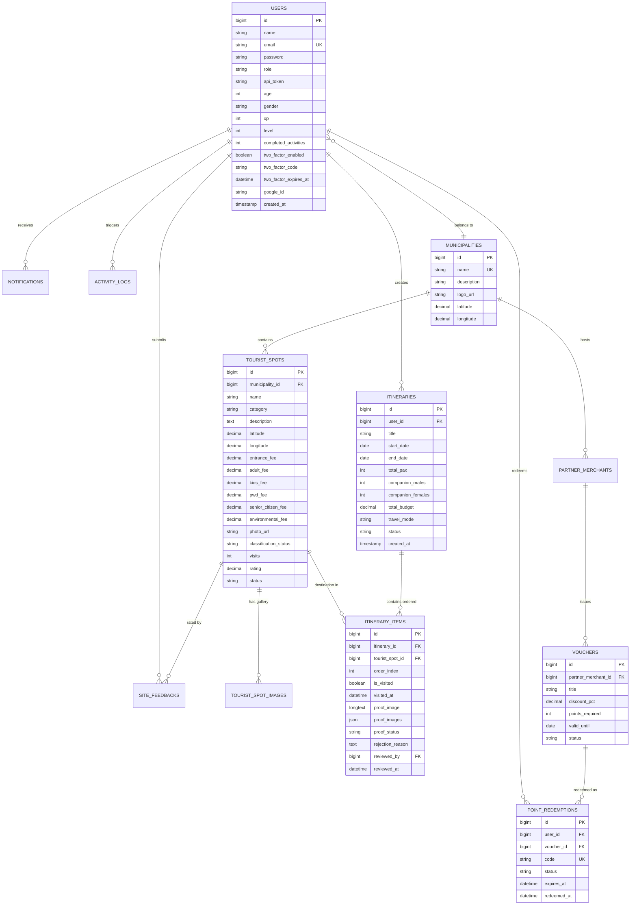

# Intan-Elyu Tourism Management System
## Backend Database Schema & Entity Relationship Specification

| **Document Version** | 2.4.0 |
| **Database Engine** | MySQL 8.0 / MariaDB 10.11 InnoDB |
| **Collation / Charset**| `utf8mb4_unicode_ci` / `utf8mb4` |
| **ORM / Migrations** | Laravel 11/12 Database Migrations & Eloquent |

---

## 1. Entity Relationship Diagram (ERD)

---

## 2. Comprehensive Table Definitions

### 2.1 `users`
Primary entity for tourists, provincial administrators (LUPTO, PITCO, PICTO), and municipal tourism officers.

| Column | Type | Modifiers | Description |
| :--- | :--- | :--- | :--- |
| `id` | `BIGINT UNSIGNED` | `AUTO_INCREMENT`, `PK` | Unique user identifier. |
| `name` | `VARCHAR(255)` | `NOT NULL` | Full name of the user. |
| `email` | `VARCHAR(255)` | `UNIQUE`, `NOT NULL` | Registered email address. |
| `password` | `VARCHAR(255)` | `NULLABLE` | Bcrypt hashed password. |
| `role` | `VARCHAR(50)` | `DEFAULT 'tourist'` | `tourist`, `lupto`, `pitco`, `picto`, `municipal`, `admin`. |
| `api_token` | `VARCHAR(80)` | `INDEX`, `NULLABLE` | Custom SHA-256 Bearer authentication token. |
| `age` | `INT UNSIGNED` | `NULLABLE` | Age demographic for statistical compliance. |
| `gender` | `VARCHAR(30)` | `NULLABLE` | `Male`, `Female`, `Non-Binary`, etc. |
| `xp` | `INT UNSIGNED` | `DEFAULT 0` | Total Experience Points accumulated. |
| `level` | `INT UNSIGNED` | `DEFAULT 1` | User level computed via `floor(xp / 1000) + 1`. |
| `completed_activities`| `INT UNSIGNED` | `DEFAULT 0` | Count of verified destination visits and check-ins. |
| `two_factor_enabled` | `BOOLEAN` | `DEFAULT FALSE` | Flag enabling Two-Factor Authentication. |
| `two_factor_code` | `VARCHAR(10)` | `NULLABLE` | 6-digit active email OTP challenge. |
| `two_factor_expires_at`| `DATETIME` | `NULLABLE` | Expiration timestamp for the active 2FA code. |
| `google_id` | `VARCHAR(255)` | `INDEX`, `NULLABLE` | Google OAuth subject identifier. |
| `avatar` | `VARCHAR(500)` | `NULLABLE` | Profile avatar URI (Cloudflare R2 or local). |
| `created_at` / `updated_at` | `TIMESTAMP` | `NULLABLE` | Record timestamps. |

### 2.2 `municipalities`
Represents the 20 local government units in the Province of La Union.

| Column | Type | Modifiers | Description |
| :--- | :--- | :--- | :--- |
| `id` | `BIGINT UNSIGNED` | `AUTO_INCREMENT`, `PK` | Municipality ID. |
| `name` | `VARCHAR(100)` | `UNIQUE`, `NOT NULL` | San Juan, San Fernando, Bacnotan, Agoo, etc. |
| `description` | `TEXT` | `NULLABLE` | Historical overview and tourism focus. |
| `logo_url` | `VARCHAR(500)` | `NULLABLE` | Official municipal seal or emblem. |
| `latitude` | `DECIMAL(10, 8)`| `NOT NULL` | Geographical centroid latitude. |
| `longitude` | `DECIMAL(11, 8)`| `NOT NULL` | Geographical centroid longitude. |

### 2.3 `tourist_spots`
Core directory of tourist destinations, attractions, beaches, and dining spots.

| Column | Type | Modifiers | Description |
| :--- | :--- | :--- | :--- |
| `id` | `BIGINT UNSIGNED` | `AUTO_INCREMENT`, `PK` | Destination identifier. |
| `municipality_id` | `BIGINT UNSIGNED` | `FOREIGN KEY` | References `municipalities(id)`. |
| `name` | `VARCHAR(255)` | `INDEX`, `NOT NULL` | Destination name. |
| `category` | `VARCHAR(100)` | `INDEX`, `NOT NULL` | Attraction, Dining, Nature, Heritage, Surfing. |
| `description` | `TEXT` | `NULLABLE` | Detailed visitor description. |
| `latitude` | `DECIMAL(10, 8)`| `NOT NULL` | GPS latitude coordinate. |
| `longitude` | `DECIMAL(11, 8)`| `NOT NULL` | GPS longitude coordinate. |
| `entrance_fee` | `DECIMAL(10, 2)`| `DEFAULT 0.00` | Base standard entrance fee. |
| `adult_fee` | `DECIMAL(10, 2)`| `NULLABLE` | Adult entrance fee. |
| `kids_fee` | `DECIMAL(10, 2)`| `NULLABLE` | Children / minor entrance fee. |
| `pwd_fee` | `DECIMAL(10, 2)`| `NULLABLE` | Persons with Disability discount fee. |
| `senior_citizen_fee` | `DECIMAL(10, 2)`| `NULLABLE` | Senior citizen discount fee. |
| `environmental_fee` | `DECIMAL(10, 2)`| `DEFAULT 0.00` | Municipal environmental conservation fee. |
| `photo_url` | `VARCHAR(500)` | `NULLABLE` | Primary high-resolution photo URL. |
| `classification_status`| `VARCHAR(50)`| `DEFAULT 'Regular'`| Priority tiers: *High Priority*, *Standard*, etc. |
| `visits` | `INT UNSIGNED` | `DEFAULT 0` | Verified visitor counter. |
| `rating` | `DECIMAL(3, 2)` | `DEFAULT 5.00` | Aggregated average rating (1.00 to 5.00). |
| `status` | `VARCHAR(50)` | `DEFAULT 'approved'`| `approved`, `pending`, `archived`. |

### 2.4 `itineraries`
Custom traveler trips containing multi-day schedules and companion tracking.

| Column | Type | Modifiers | Description |
| :--- | :--- | :--- | :--- |
| `id` | `BIGINT UNSIGNED` | `AUTO_INCREMENT`, `PK` | Unique itinerary ID. |
| `user_id` | `BIGINT UNSIGNED` | `FOREIGN KEY` | References `users(id)` on delete cascade. |
| `title` | `VARCHAR(255)` | `NOT NULL` | Custom trip title (e.g. "Weekend Surf & Waterfalls"). |
| `start_date` | `DATE` | `NOT NULL` | Trip commencement date. |
| `end_date` | `DATE` | `NOT NULL` | Trip conclusion date. |
| `total_pax` | `INT UNSIGNED` | `DEFAULT 1` | Total traveler count. |
| `companion_males` | `INT UNSIGNED` | `DEFAULT 0` | Number of male companions in travel party. |
| `companion_females`| `INT UNSIGNED` | `DEFAULT 0` | Number of female companions in travel party. |
| `total_budget` | `DECIMAL(12, 2)`| `DEFAULT 0.00` | Estimated or allocated trip budget (PHP). |
| `travel_mode` | `VARCHAR(50)` | `DEFAULT 'commute'`| `commute` (jeep/trike) or `private` (car/motor). |
| `status` | `VARCHAR(50)` | `DEFAULT 'active'` | `active`, `completed`, `archived`. |

### 2.5 `itinerary_items`
Individual destination stops linked to itineraries, supporting ordering, verification, and photo audits.

| Column | Type | Modifiers | Description |
| :--- | :--- | :--- | :--- |
| `id` | `BIGINT UNSIGNED` | `AUTO_INCREMENT`, `PK` | Item identifier. |
| `itinerary_id` | `BIGINT UNSIGNED` | `FOREIGN KEY` | References `itineraries(id)` on delete cascade. |
| `tourist_spot_id` | `BIGINT UNSIGNED` | `FOREIGN KEY` | References `tourist_spots(id)`. |
| `order_index` | `INT UNSIGNED` | `DEFAULT 0` | Sorting sequence index within the itinerary. |
| `is_visited` | `BOOLEAN` | `DEFAULT FALSE` | True if verified or approved check-in. |
| `visited_at` | `DATETIME` | `NULLABLE` | Timestamp when destination visit occurred. |
| `proof_image` | `LONGTEXT` | `NULLABLE` | Primary photo proof URL or base64 fallback. |
| `proof_images` | `JSON` | `NULLABLE` | Array of additional uploaded photo proof URLs. |
| `proof_status` | `VARCHAR(50)` | `DEFAULT 'pending'`| `pending`, `approved`, `rejected`. |
| `rejection_reason` | `TEXT` | `NULLABLE` | Reason logged by audit staff if rejected. |
| `reviewed_by` | `BIGINT UNSIGNED` | `NULLABLE` | Admin/Officer ID who audited submission. |
| `reviewed_at` | `DATETIME` | `NULLABLE` | Timestamp of administrative audit decision. |

### 2.6 `vouchers` & `point_redemptions`
Handles the partner merchant loyalty and discount marketplace.

| Table | Column | Type | Description |
| :--- | :--- | :--- | :--- |
| `vouchers` | `id` | `BIGINT UNSIGNED (PK)` | Unique voucher ID. |
| `vouchers` | `partner_merchant_id` | `BIGINT UNSIGNED (FK)` | Issuer merchant business. |
| `vouchers` | `title` | `VARCHAR(255)` | E.g., "15% Off Surf Rental". |
| `vouchers` | `points_required` | `INT UNSIGNED` | Points needed to redeem. |
| `point_redemptions` | `id` | `BIGINT UNSIGNED (PK)` | Redemption record ID. |
| `point_redemptions` | `user_id` | `BIGINT UNSIGNED (FK)` | Redeeming tourist. |
| `point_redemptions` | `voucher_id` | `BIGINT UNSIGNED (FK)` | Target voucher. |
| `point_redemptions` | `code` | `VARCHAR(50) (UK)` | Dynamic QR validation code. |
| `point_redemptions` | `status` | `VARCHAR(30)` | `active`, `claimed`, `expired`. |

---

## 3. Indexing & Scaling Optimizations

1. **Composite Geolocation Lookups**: `tourist_spots(latitude, longitude, category)` for fast map bounds bounding-box queries.
2. **Itinerary Retrieval**: `itinerary_items(itinerary_id, order_index)` with foreign key cascade to guarantee microsecond trip list rendering.
3. **Audit Queue Filtering**: `itinerary_items(proof_status, created_at)` allowing municipal staff to review pending photo check-ins instantly without full-table scans.
4. **Leaderboard Performance**: Periodic materialization and cache tagging (`leaderboard_cache`) avoiding expensive runtime SUM/COUNT joins on large user populations.
