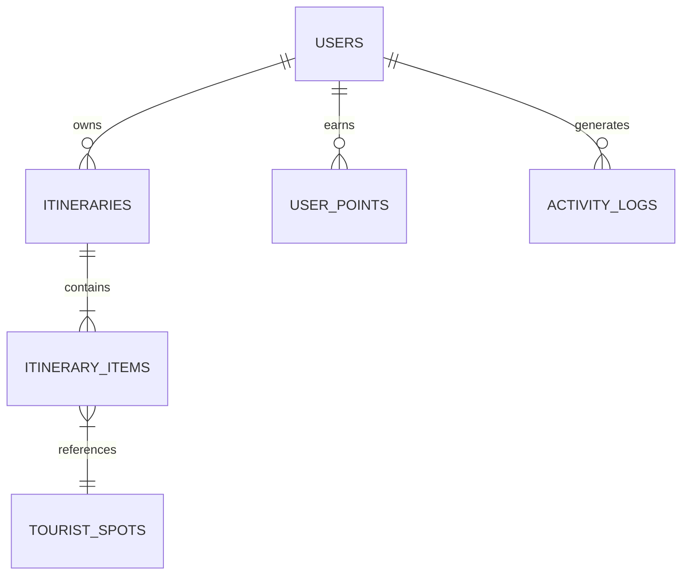

# API & Database Schema

The backend architecture is built with **Laravel 10** providing RESTful JSON APIs to the mobile client.

Connected Subsystems: [[offline-sync-engine]], [[itinerary-system]], [[gamezone-and-rewards]], [[mobile-pwa-architecture]]

---

## Core Tourist Endpoints

- `GET /api/tourist/itineraries` — Retrieve list of saved itineraries.
- `POST /api/tourist/itineraries` — Create a new itinerary.
- `PUT /api/tourist/itineraries/{id}` — Update existing itinerary destinations, dates, and transport mode.
- `DELETE /api/tourist/itineraries/{id}` — Delete a saved itinerary.
- `POST /api/tourist/points/minigame` — Award XP and points for mini-games.
- `POST /api/tourist/points/redeem` — Claim vouchers with earned points.

---

## Database Relational Architecture

---

> [!TIP]
> Refer to [[offline-sync-engine]] for how client sync calls these REST endpoints on reconnection.
