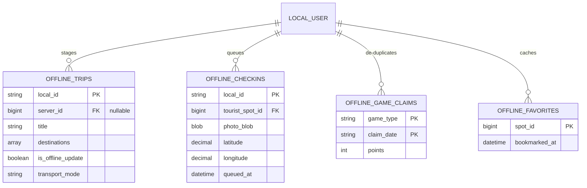

# Mobile Crow's Foot ERD (Entity-Relationship Diagram)

This document contains the complete **Crow's Foot Notation** Entity-Relationship Diagram for the **Intan-Elyu Mobile Subsystem** (Tourist PWA & Android Capacitor client).

Connected Subsystems: [[api-and-database]], [[offline-sync-engine]], [[itinerary-system]], [[gamezone-and-rewards]], [[mobile-pwa-architecture]]

---

## 1. Visual Crow's Foot Notation Diagram

> [!TIP]
> **Clean Engineering Blueprint ERD:**
> - Open interactive viewer: [mobile-erd-viewer.html](file:///c:/xampp/htdocs/Intan-Elyu-Tourism-Management-System/docs/mobile-erd-viewer.html)
> - Direct Vector SVG: [intan-elyu-mobile-erd.svg](file:///c:/xampp/htdocs/Intan-Elyu-Tourism-Management-System/docs/intan-elyu-mobile-erd.svg)
> 
> Below is the interactive visual diagram:


---

## 2. Textual ERD Definition (Mermaid Code)
erDiagram
    MUNICIPALITIES ||--o{ TOURIST_SPOTS : contains
    MUNICIPALITIES ||--o{ USERS : "resides in"
    MUNICIPALITIES ||--o{ VOUCHERS : "issued by"

    USERS ||--o{ ITINERARIES : plans
    USERS ||--o{ FAVORITES : bookmarks
    USERS ||--o{ SITE_FEEDBACKS : submits
    USERS ||--o{ POINT_REDEMPTIONS : claims
    USERS ||--o{ NOTIFICATIONS : receives
    USERS ||--o{ ACTIVITY_LOGS : generates

    ITINERARIES ||--|{ ITINERARY_ITEMS : contains
    TOURIST_SPOTS ||--o{ ITINERARY_ITEMS : "included in"
    TOURIST_SPOTS ||--o{ TOURIST_SPOT_IMAGES : displays
    TOURIST_SPOTS ||--o{ FAVORITES : "saved as"
    TOURIST_SPOTS ||--o{ SITE_FEEDBACKS : "evaluated by"

    VOUCHERS ||--o{ POINT_REDEMPTIONS : "redeemed via"

    USERS {
        bigint id PK
        string name
        string email
        string role "tourist"
        bigint municipality_id FK
        int xp "gamification XP"
        int level "explorer level"
        int points "redeemable points"
        int completed_activities
        string avatar
    }

    MUNICIPALITIES {
        bigint id PK
        string name
        string district
        decimal latitude
        decimal longitude
    }

    TOURIST_SPOTS {
        bigint id PK
        bigint municipality_id FK
        string name
        string category
        string classification_status
        decimal latitude
        decimal longitude
        decimal entrance_fee
        decimal environmental_fee
        int visits
        float rating
        string status
    }

    TOURIST_SPOT_IMAGES {
        bigint id PK
        bigint spot_id FK
        string photo_url
        int sort_order
    }

    ITINERARIES {
        bigint id PK
        bigint user_id FK
        string title
        date trip_date
        decimal budget
        decimal total_cost
        string transport_mode
        string route_type
        string status
    }

    ITINERARY_ITEMS {
        bigint id PK
        bigint itinerary_id FK
        bigint tourist_spot_id FK
        int order_index
        boolean is_visited
        datetime visited_at
        string proof_image
        string proof_status
        string transport_mode
        decimal leg_cost
        decimal leg_distance_km
    }

    FAVORITES {
        bigint id PK
        bigint user_id FK
        bigint tourist_spot_id FK
    }

    SITE_FEEDBACKS {
        bigint id PK
        bigint user_id FK
        bigint tourist_spot_id FK
        int rating
        text testimony
        text policy_recommendation
        string crowd_level
        string cleanliness_level
        string safety_level
    }

    VOUCHERS {
        bigint id PK
        bigint municipality_id FK
        string voucher_code
        string voucher_name
        string discount_type
        decimal discount_value
        int required_points
        int remaining_quantity
        datetime expires_at
    }

    POINT_REDEMPTIONS {
        bigint id PK
        bigint user_id FK
        int points_cost
        string voucher_code
        string status
    }

    NOTIFICATIONS {
        bigint id PK
        bigint user_id FK
        string type
        string title
        text message
        boolean is_read
    }

    ACTIVITY_LOGS {
        bigint id PK
        bigint user_id FK
        string action
        text details
        string ip_address
    }
```

---

## 2. Cardinality Legend

| Symbol | Syntax | Cardinality | Meaning |
| :---: | :---: | :---: | :--- |
| `\|\|` | `\|\|--\|\|` | 1:1 | **Mandatory One**: Exactly one occurrence |
| `\|o` | `\|\|--o\|` | 0:1 | **Optional One**: Zero or one occurrence |
| `\|{` | `\|\|--\|{` | 1:N | **Mandatory Many**: One or more occurrences |
| `o{` | `\|\|--o{` | 0:N | **Optional Many (Crow's Foot)**: Zero, one, or many occurrences |

---

## 3. Client-Side Offline Storage Queue

For full offline capability, `frontend/Mobile/` maintains local mirrored queues when without internet connection:


