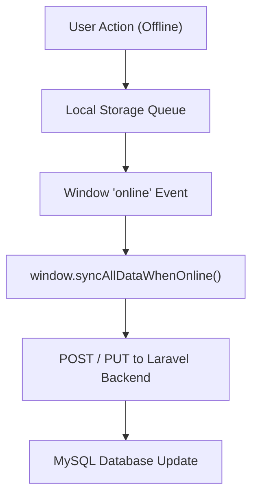

# Offline Sync Engine

The **Offline Sync Engine** ensures that tourist actions performed with zero network connectivity are preserved locally and pushed automatically once online.

Connected Subsystems: [[itinerary-system]], [[gamezone-and-rewards]], [[api-and-database]], [[mobile-pwa-architecture]]

---

## Architecture Overview

## Core Managers

1. **`OfflineTripManager`** (`main.js`):
   - Manages `intan_elyu_offline_saved_trips`.
   - Supports creating new trips (`POST`) and editing existing trips in-place (`PUT` with `update_id`).
   - Connected to [[itinerary-system]].

2. **`OfflineCheckinManager`** (`main.js`):
   - Queues GPS check-ins and camera photo uploads.
   - Preserves binary image blobs across app reloads using IndexedDB/localStorage.

3. **`OfflineGameClaimsManager`** (`main.js`):
   - De-duplicates claims to respect daily game limits.
   - Connected to [[gamezone-and-rewards]].

4. **`OfflineFavoriteManager` & `OfflineCompletedTripsManager`**:
   - Manages spot bookmarking and itinerary completion status.

---

> [!NOTE]
> All offline queues trigger automatic execution through `window.syncAllDataWhenOnline()` when `navigator.onLine` emits `true`.
